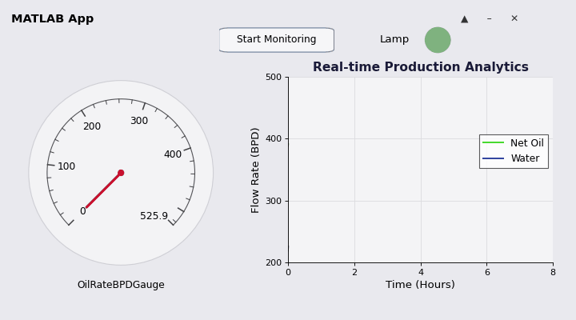

# Subsea Multiphase Flow Metering (MPFM) & Real-Time Analytics Dashboard

An end-to-end engineering simulation of a Virtual Multiphase Flow Metering (VFM) platform designed for subsea oil and gas applications. Built entirely using MATLAB and App Designer, this project bridges multiphase fluid dynamics, digital signal processing, and real-time dashboard instrumentation using synthetic data generated from open industry physics principles.

🚀 Project Architecture

The repository is modularized into three core algorithmic and visual phases:

1. Mathematical Modeling & Data Generation (Data_Generator.m)
Simulates a 24-hour time-series production profile of a subsea hydrocarbon well containing three mixed fluid phases: Oil, Water, and Gas.
Implements physical forward-modeling formulas:
- Venturi Differential Pressure (dP): Based on Bernoulli’s principles governed by transient mixture densities.
- Electrical Impedance Signatures: Derived from physical fluid conductivity properties to determine the Water Liquid Ratio (WLR).
- Introduces real-world dynamic distortions including complex hydraulic noise and slugging phenomena (unstable large gas bubbles/fluid surges).

2. Data Cleaning & Sensor Fusion Analytics (Data_Analytics.m)
Acts as an offline processing model demonstrating typical cloud-based multiphase analytics pipeline.
- Applies advanced moving-average smoothing filters to remove steep multi-phase transient noise and spikes.
- Employs inverse physical equations (Sensor Fusion) to extract net production yields, decoding raw (dP) and electrical impedance into net volumetric flow rates.

3. Interactive Industrial Interface (VFM_Dashboard.mlapp)
A standalone control panel built via MATLAB App Designer that executes a fast real-time production playback.
- Automatically processes streaming matrix streams using high-speed animatedline configurations to prevent web dashboard freezing.
- Features proactive automation logic: A smart status indicator (Lamp) dynamically triggers an immediate alert (changes color from Green to Red) if the calculated WLR spikes past safe boundary levels (>40%).

🛠️ Tech Stack & Methods
- Language/Environment: MATLAB, MATLAB Drive, MATLAB Online.
- Frameworks: MATLAB App Designer, Signal Processing & Automation Controls.
- Engineering Principles: Fluid Mechanics, Bernoulli's Principle, Empirical Electrical Mapping.

📊 Sample Visualizations

💻 How to Run the Project

1. Click the *Open in MATLAB Online* badge at the top of this page to run the project instantly in your browser, or clone this repository to your local machine.
2. Run Data_Generator.m to generate the raw hydro-sensor matrices (Raw_Sensor_Data.mat).
3. Run Data_Analytics.m to process the inputs and export the production arrays (Analytics_Results.mat).
4. Open and run VFM_Dashboard.mlapp in App Designer, then click the "Start Monitoring" button to initiate the live dynamic playback loop.

📝 Disclaimer
This project is an independent engineering study built entirely on publicly available physics equations and synthetically generated data. It does not contain, use, or replicate any proprietary code, confidential algorithms, or intellectual property from any specific commercial entity.
